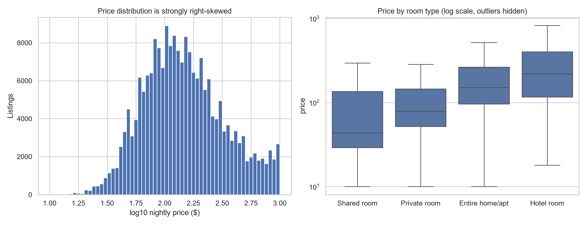
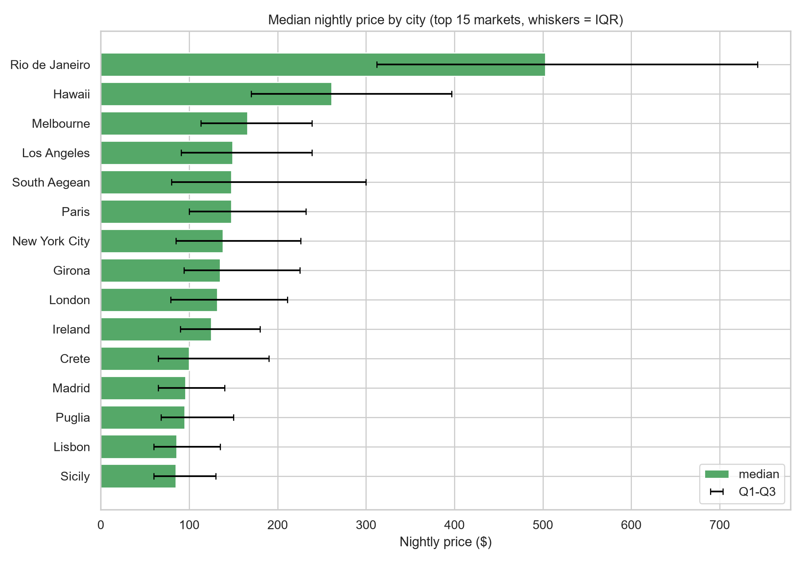
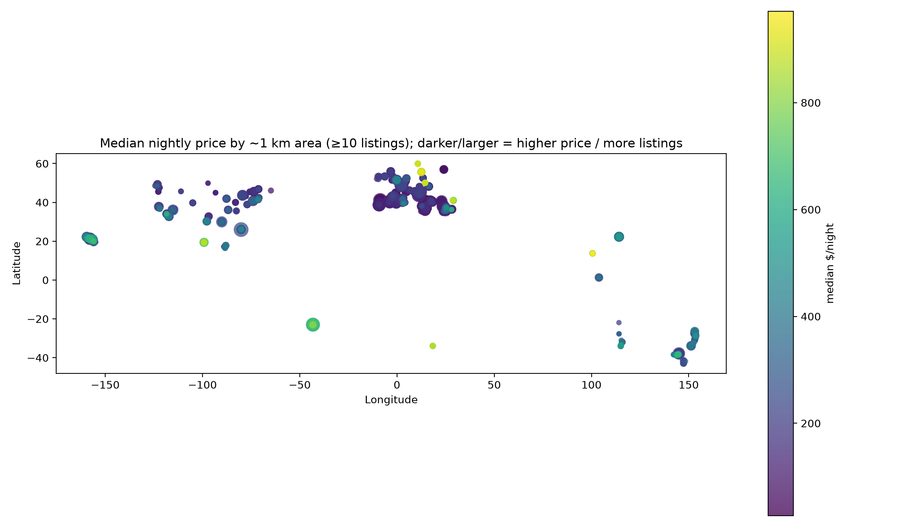
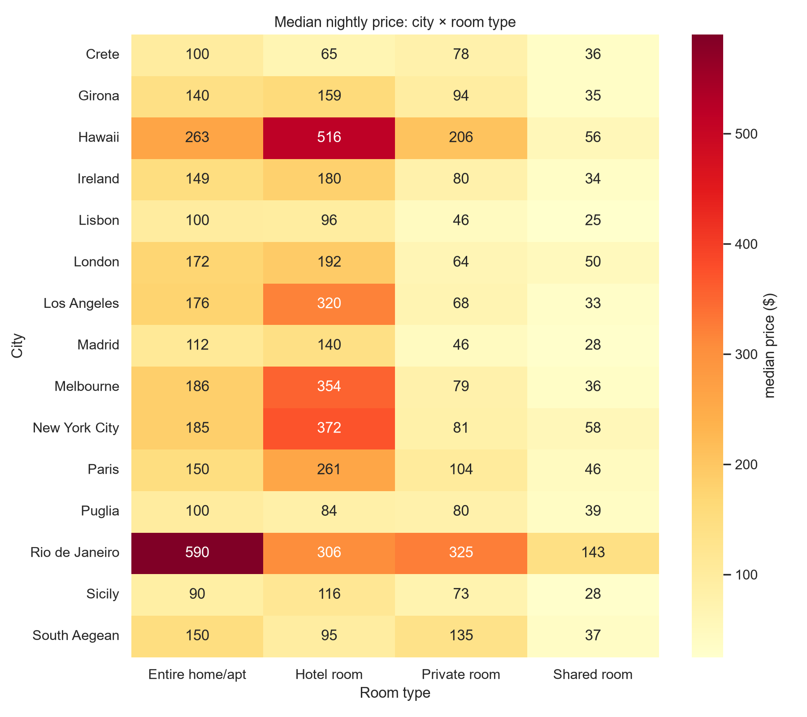
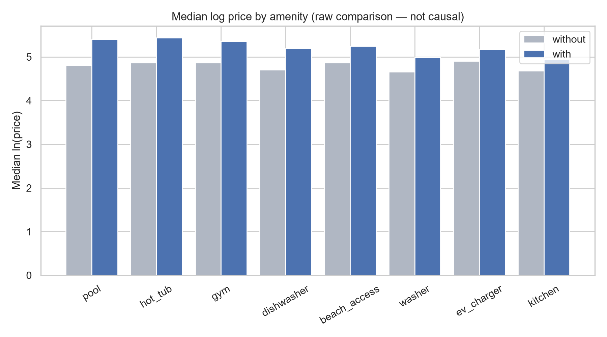
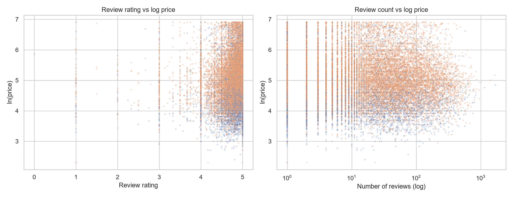
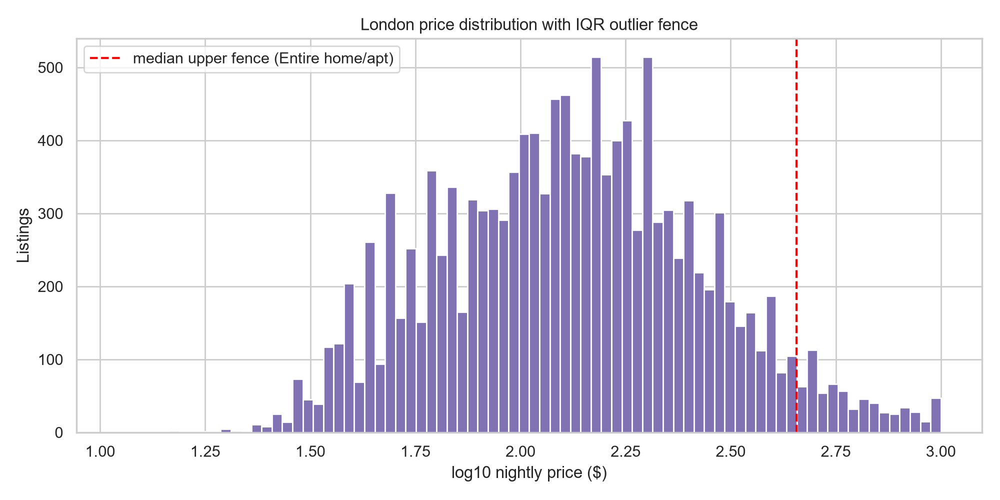
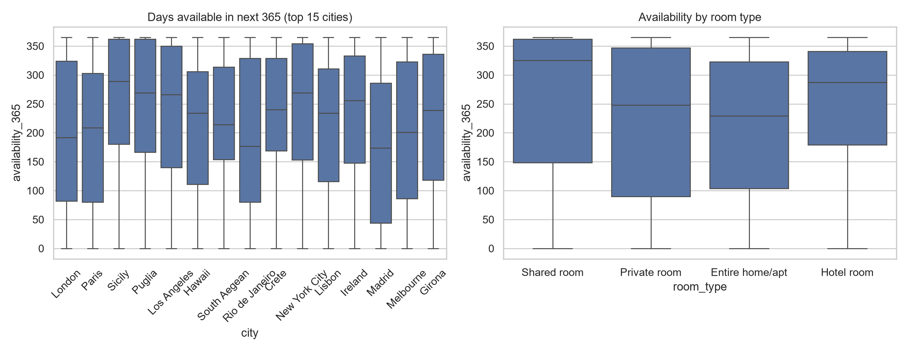

# Benchmarking Nightly Prices in Airbnb Listings

**For property managers and marketplace teams:** this project analyses 208,839 Airbnb listings across 108 cities to answer one practical question — *is a listing priced unusually high or low compared with genuinely comparable properties, and which observable features are associated with price differences?*

> Price here means the **advertised nightly rate**, not realised revenue. The analysis identifies associations, not causes, and cannot measure profitability (no fees, costs, occupancy or seasonality data exist in the dataset).

---

## The headline numbers

| Question | Answer |
|---|---|
| What does a typical night cost? | **$136 median** (mean $207 — prices are heavily skewed, so medians are used throughout) |
| Where are prices highest? | Oslo ($835), Copenhagen ($807), Prague & Bangkok ($799) — versus budget markets far below the median |
| What earns a premium? | Size and capacity: each extra guest ≈ **+9%**, bedroom ≈ **+8%**, bathroom ≈ **+10%** |
| Do reviews matter? | Top-rated listings (4.8+) price **~5% above** their local segment; review *count* barely matters |
| How good is the price model? | Beats the simple "city + room type median" benchmark on every metric: **MAE $74 vs $88**, RMSE $129 vs $151 |
| How many listings look anomalous? | **6.8%** fall outside the normal range for their city × room type |



*Nightly prices are strongly right-skewed — which is why every comparison in this project uses medians and interquartile ranges rather than means alone.*

---

## Where prices are highest — and why location dominates

Premium coastal and capital markets (Oslo, Copenhagen, Prague, Bangkok, Cape Town) sit far above the global median. Because the source "neighbourhood" field is free text, area-level analysis uses ~1 km geographic cells; the interactive map is the clearest view of price geography.



*Median nightly price for the top 15 markets; whiskers show the interquartile range. Note how wide the IQRs are — a "city average" hides enormous variation.*



*Median price by ~1 km area (static version — the interactive version is in the dashboard and at `outputs/dashboard/airbnb_price_map.html`). Darker, larger bubbles = higher prices and more listings.*

---

## What earns a premium

### 1. Room type — compare like-for-like only



*Median price by city and room type. Entire homes roughly double private-room medians; hotel rooms show the widest spread. Comparing across columns or rows without this segmentation would be misleading.*

### 2. Size, capacity and amenities

The strongest price associates are capacity (`accommodates`, r ≈ 0.41) and space (`bedrooms` 0.37, `bathrooms` 0.32, `beds` 0.31), followed by amenity count. Each additional guest corresponds to ~+9%, each bedroom ~+8%, each bathroom ~+10% in the model — associations, not guaranteed effects.



*Median log-price with vs without key amenities. Raw comparison — amenity listings also tend to be larger/better-located, so these gaps overstate the amenity's own effect.*

### 3. Reviews: quality yes, quantity no



*Top panel: rating vs price — a visible but modest gradient. Bottom panel: review count vs price — essentially flat.*

The cleanest evidence is within-segment: listings rated **4.8–5.0 price ~5% above** their own city × room-type median, while ratings under 4.0 sit ~5–9% below (`outputs/tables/rating_band_summary.csv`). Review *count* is uncorrelated with price — an established listing with 50+ reviews is, if anything, priced slightly *below* segment median.

---

## Data quality: are the prices believable?

- **17 implausible prices** (<$10 or >$2,000) removed; **0 missing prices, coordinates or duplicate IDs**.
- **14,242 listings (6.8%)** fall outside the normal range for their city × room type — flagged with per-segment IQR fences, not deleted, since luxury listings legitimately price high.
- **936 listings sit at exactly $1,000** — the observed platform price cap.
- 19.5% of listings have no review score (no reviews yet) — kept as "no score", never silently imputed.



*London's price distribution with the median upper IQR fence for entire homes/ apartments. The tail beyond the fence is investigated, not assumed erroneous.*

Full detail: `outputs/reports/data_quality_report.md`.

---

## Availability is not demand

Median days available in the next 365 range from **87 (Copenhagen)** to **358 (Istanbul)** — and the lowest-availability cities are disproportionately the highest-priced ones, consistent with tighter listed supply in premium markets. By room type, shared rooms are most available (325d median) and entire homes least (229d).



**Caveat:** availability mixes real bookings, host-blocked dates and minimum-stay rules. Low availability alone cannot prove demand — verify against actual booking records before acting on it.

---

## Can a model estimate a reasonable price? Yes — as a benchmark, not a profit tool

OLS on log-price with an 80/20 holdout, compared against the required simple benchmark (median price by city × room type):

| Model | MAE ($) | RMSE ($) | log-MAE | log-RMSE |
|---|---|---|---|---|
| Regression (capped at $1,000) | **74.13** | **128.70** | 0.370 | 0.487 |
| Median by city × room type | 88.40 | 151.43 | 0.453 | 0.595 |
| Global median | 124.66 | 209.76 | — | — |

The model wins on every metric. Without capping, exponentiating log predictions occasionally produces implausible values (up to ~$27k); capping at the observed $1,000 ceiling is a documented, necessary correction. Predictions for all 52,805 test listings: `outputs/predictions/airbnb_test_predictions.csv`.

---

## What this means for decisions

1. **Benchmark like-for-like first.** Compare a listing's price to the median/IQR for its *own city × room type* — downloadable from the dashboard. Deviations beyond Q3 + 1.5·IQR warrant review, but may reflect unobserved quality.
2. **Capacity and space are the strongest levers** in the data — ahead of amenities, reviews or host traits.
3. **A 4.8+ guest rating is worth roughly +5%** versus comparable listings — modest but plausibly achievable through cleanliness, accuracy and communication.
4. **Don't read low availability as high demand** — it may reflect host blocks; verify with booking data.
5. **Use the model as a sanity check**: a listing priced far above its prediction should be justified by amenities, views or fit-out quality the data cannot see.

---

## Explore the data yourself

**Live dashboard** (recommended):

```bash
python -m venv .venv
.venv/Scripts/pip install -r requirements.txt      # Windows
.venv/bin/pip install -r requirements.txt          # macOS/Linux
.venv/Scripts/python -m streamlit run src/05_dashboard.py
```

Open http://localhost:8501 — filter by city, room type, price range, availability and rating; views include price distributions, comparisons, availability, a benchmark table and an interactive map.

**Static outputs** (no setup needed):

| Deliverable | Location |
|---|---|
| Final report (full analysis + limitations) | `outputs/reports/final_report.md` |
| Data-quality & outlier report | `outputs/reports/data_quality_report.md` |
| Benchmark table: median & IQR by city × room type | `outputs/tables/segment_summary.csv` |
| City price summary | `outputs/tables/city_summary.csv` |
| Model metrics vs benchmark | `outputs/tables/model_metrics.csv` |
| Model coefficients | `outputs/tables/model_coefficients.csv` |
| Interactive price map | `outputs/dashboard/airbnb_price_map.html` |
| Test-set price predictions | `outputs/predictions/airbnb_test_predictions.csv` |

---

## Reproducing the analysis

```bash
.venv/Scripts/python src/01_clean.py     # clean + engineer features
.venv/Scripts/python src/02_eda.py       # descriptive analysis + figures
.venv/Scripts/python src/03_map.py       # geographic map
.venv/Scripts/python src/04_model.py     # regression + holdout evaluation
.venv/Scripts/python src/05_dashboard.py # interactive dashboard
```

**Data note:** the CSV datasets (~460 MB) are intentionally not in git — they live in `rental price/` locally and are listed in `.gitignore`.

## Honest limitations

- **Advertised price ≠ revenue, bookings or profit.** No fees, costs, seasonality, events or property-quality variables exist in the data — profitability cannot be assessed.
- `estimated_occupancy_l365d` / `estimated_revenue_l365d` are review-based *estimates*, used only as cautious proxies.
- 108 cities of very unequal size — tail markets lack enough listings for reliable benchmarks.
- Prices appear capped at $1,000, truncating the true upper tail; neighbourhood identity is approximated by ~1 km geo-cells because the source field is free text.
- All reported relationships are **associations** — the data cannot show that changing a feature causes a price change.
